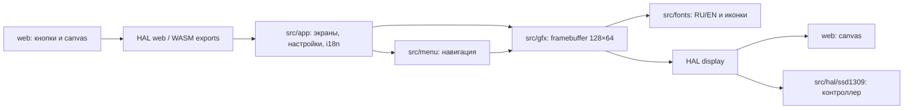

# Архитектура OLED Menu Emulator

Актуализация: 2026-10-22. Приложение уже существует; график пока только запланирован.

Ядро C11 freestanding без libc и динамических зависимостей. Framebuffer — 1024 байта
в раскладке SSD1309. `gfx_line` уже использует целочисленный алгоритм Брезенхэма.
Меню рисует заголовок перед экраном, экран должен использовать оставшуюся область.
`app_tick(elapsed_ms)` обновляет время, датчики, уведомления и автосон.

| Слой | Ответственность | Проверки |
| --- | --- | --- |
| src/gfx, src/fonts | Пиксели, примитивы, UTF-8, генерируемые таблицы | C unit, формат, freestanding |
| src/menu | Навигация, подменю, редактирование значений | C unit и e2e |
| src/app | Датчики, экраны, RU/EN, настройки | C unit и e2e |
| src/hal | Отделение браузера и платы | Тест потока SSD1309, ARM syntax check |
| web | Кнопки и вывод памяти WASM в canvas | ESLint, Prettier, Playwright |
| scripts/hooks | Защита файлов, линтер, контекст | node:test в tests/hooks |

## Контур агента

AGENTS.md → Graft (адресный контекст) → STATE/Discovery → PLAN → изменения →
хуки → lint/unit/e2e → проверка результата → SUMMARY/журнал → checkpoint.

`.planning/STATE.md` определяет текущую фазу, `docs/plan.md` хранит общий бэклог,
`docs/memory.md` — решения и ловушки. SessionStart подаёт только состояние,
10 открытых задач и последнюю запись журнала. PreCompact сохраняет тот же пакет
в `docs/context-checkpoint.md`; Codex может вызвать его через npm-команду.

Проверенные точки расширения графика: `src/gfx/gfx.c:61–85`,
`src/app/app.c:297–308`, `src/menu/menu.c:211–257` (Graft, 2026-10-22).
Новый буфер и draw-функция относятся к app, движок меню менять не требуется.

Автоматизация не заменяет авторизацию: merge/push остаются человеку. Команды GSD
используют уже установленный runtime; файлы ядра GSD не копируются в репозиторий.
