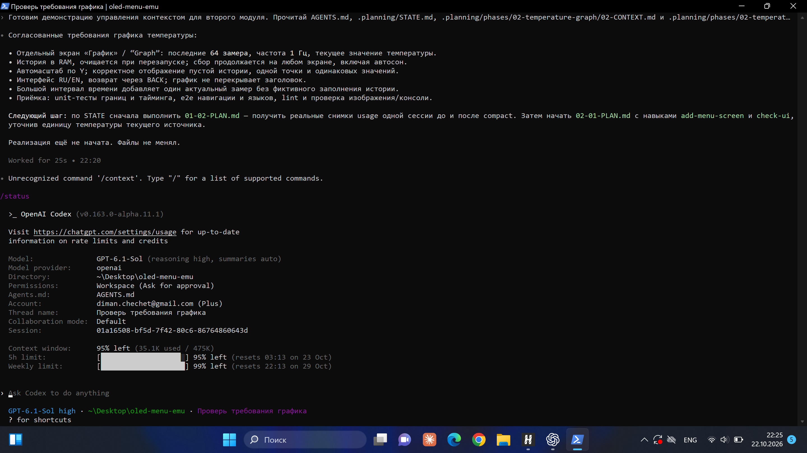
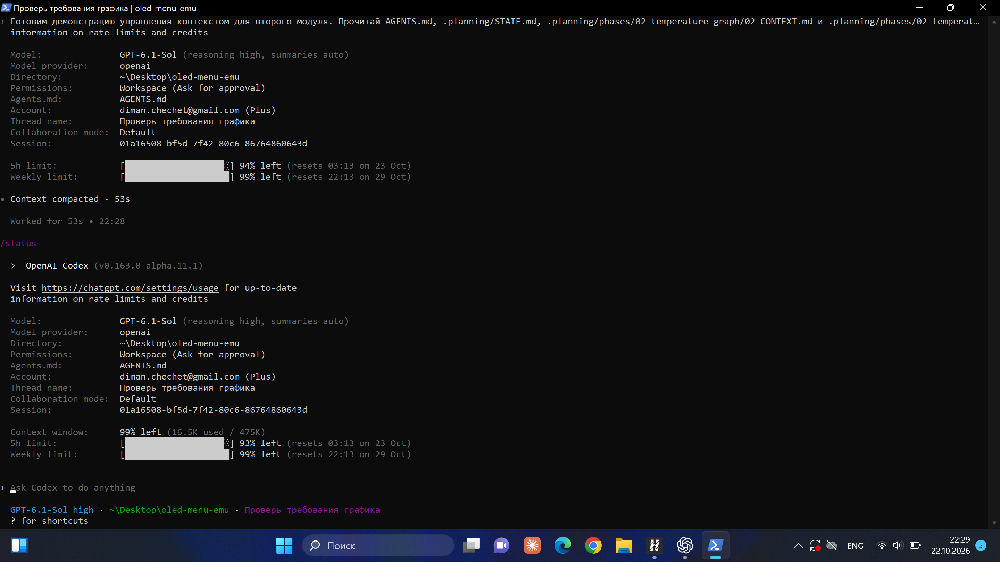
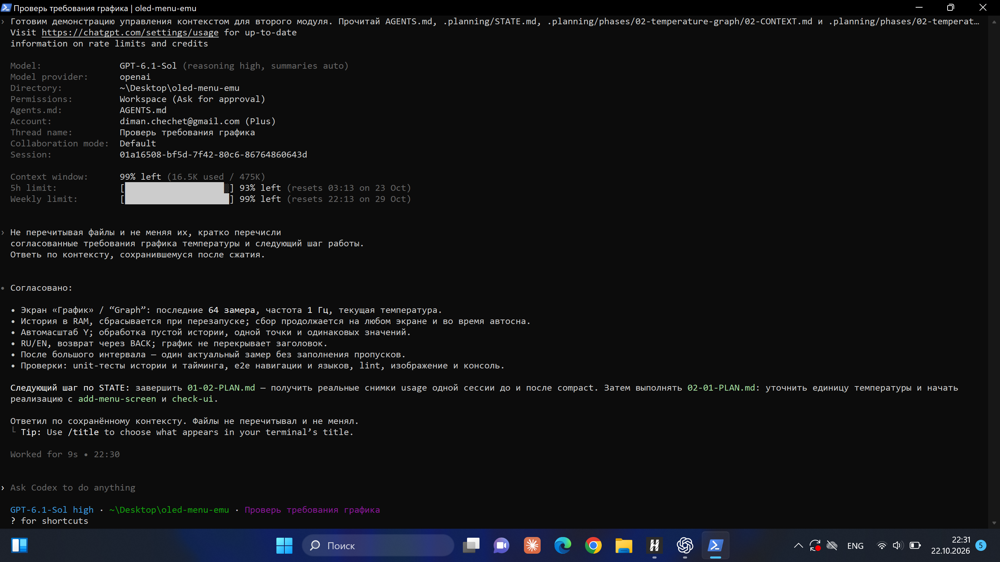

# Доказательство управления контекстом

Статус 2026-10-22: пользователь выполнил ручное сжатие в Codex CLI и передал
снимки до/после и проверки сохранения требований. CTX-01 выполнен.

## Что внедрено

- Адресное чтение через Graft вместо загрузки файлов целиком.
- `npm run agent:resume`: STATE, 10 открытых задач и последняя запись памяти.
- `npm run agent:checkpoint`: сохранение пакета в `docs/context-checkpoint.md`.
- Claude Code: PreCompact создаёт чекпойнт перед manual/auto compact; SessionStart
  восстанавливает актуальные файлы, в том числе после compact. Хуки нужно загрузить
  в доверенном проекте и проверить в `/hooks`.
- Codex: команды resume/checkpoint доступны из терминала. Новый PreCompact для Codex
  не добавлялся; автоматическое срабатывание этого события в Codex не заявляется.

Чекпойнт сокращает объём повторного чтения, но сам не изменяет историю текущего чата.
Проценты из GSD progress — выполнение планов, а не usage контекстного окна.
Размер файла в байтах и оценка экономии Graft также не заменяют token usage.

## Фактическая демонстрация в Codex CLI

1. Запущен Codex CLI из папки проекта. Для обнаруженного бинарника приложения
   потребовался флаг `--no-daemon`; это особенность данного запуска.
2. Агент прочитал AGENTS.md, STATE, Discovery и план графика и перечислил требования.
3. Пользователь выполнил `/status` и снял строку `Context window` до сжатия.
4. Выполнен `/compact`; клиент показал `Context compacted · 53s`.
5. После завершения повторно выполнен `/status`, до новых запросов агенту.
6. Без перечитывания файлов агент повторил требования и следующий шаг по сохранённому
   контексту. На снимке ответа нет вызовов инструментов чтения.

Команды `/status` и `/compact` подтверждены меню установленного клиента.
`/context` в этой версии Codex не поддерживается: это команда Claude Code.
Первый `/status` во время сжатия не показал `Context window`; для результата
использован повторный замер после сообщения об успешном завершении.

| Факт | Значение |
| --- | --- |
| Клиент, версия, модель | Codex CLI v0.163.0-alpha.11.1, GPT-6.1-Sol, reasoning high |
| Дата | 2026-10-22, около 22:25–22:31, Москва |
| Одна сессия | 01a16508-bf5d-7f42-80c6-86764860643d |
| Usage до | 35.1K used / 475K; клиент показывает 95% left |
| Операция | Ручной /compact; сообщение Context compacted · 53s |
| Usage после | 16.5K used / 475K; клиент показывает 99% left |
| Сокращение | Около 18.6K токенов, примерно 53% от исходного used |
| Решения восстановлены | Да: 64 замера, 1 Гц, RAM, autoscale, RU/EN, BACK и следующий план |

Сравниваются округлённые значения **used** из `Context window` одной модели и сессии.
Сокращение приблизительное. Значения `5h limit` и `Weekly limit` относятся к квоте
аккаунта и не используются для расчёта. Проценты left записаны как показаны клиентом;
формулу их расчёта этот отчёт не устанавливает.

### До сжатия

### После сжатия

### Проверка сохранения требований

Следующий шаг в ответе агента ещё ссылается на незакрытый 01-02-PLAN.md: это корректное
воспроизведение состояния на момент демонстрации. После получения снимков документы
обновлены, план закрыт. Реализация графика не начата.

Эта демонстрация подтверждает встроенный compact Codex. Она не подтверждает запуск
PreCompact в Claude Code или автоматическое сохранение чекпойнта при compact в Codex.

Источники: [Claude Code hooks](https://code.claude.com/docs/en/hooks#precompact),
[управление контекстом Claude Code](https://code.claude.com/docs/en/costs),
[описание compaction OpenAI](https://developers.openai.com/cookbook/examples/gpt-5/codex_prompting_guide#compaction).
