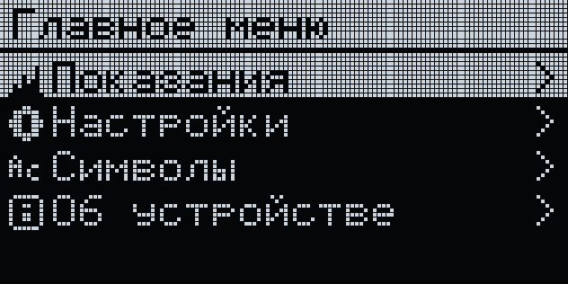

# Модуль 2 — результаты подготовки окружения

Дата: 2026-10-22. Ветка: `feat/agent-pipeline`. Работа выполнена для существующего
OLED Menu Emulator текущим агентом, последовательно, без независимых агентов.

## GSD Core и структура

Подтверждена существующая установка `~/.codex/gsd-core`, VERSION **1.18.0**,
runtime `codex`, Node **v22.23.3**. Повторная установка не выполнялась.
На другой машине нужна установка GSD Core и его навыков для выбранного агента.

Созданы PROJECT, REQUIREMENTS, ROADMAP, STATE, config и планы двух фаз:
агентный пайплайн и график температуры. Архитектура и security checklist — в docs.
GSD CLI вызывается через переносимую Node-обёртку без новых npm-пакетов.
Это ручная адаптация структуры GSD для существующего проекта; полный workflow
$gsd-new-project / $gsd-plan-phase / $gsd-execute-phase не запускался.

## Память, команды и auto hooks

Аналог Claude Mem — версионируемая файловая память. STATE хранит текущий шаг,
docs/plan.md — бэклог, docs/memory.md — решения и ловушки. Команда resume и
SessionStart читают текущее состояние, 10 задач и последнюю запись журнала.
Checkpoint сохраняет пакет для продолжения после сжатия/смены чата.
Graft даёт адресный контекст кода до чтения исходников.

Добавлены agent:doctor, agent:resume, agent:checkpoint, gsd:progress, gsd:check,
test:hooks. Существующие PreToolUse и PostToolUse сохранены. В Claude Code
добавлен PreCompact; обработчик проверен JSON-событием. Ручной compact показан
в пользовательской сессии Codex CLI; реальный запуск PreCompact в Claude Code
в этой демонстрации не проверялся. В Codex доступны переносимые npm-команды,
новый PreCompact для него не добавлялся.

Тесты hooks включены в CI. Исправлен CRLF в sync-agents: YAML правил корректно
удаляется на Windows, повторный --check не находит расхождений.
Существующие изменения пользователя для Graft сохранены.

## Контекст и доказательства

Пользователь выполнил `/status` → `/compact` → `/status` в одной сессии Codex CLI
v0.163.0-alpha.11.1 на GPT-6.1-Sol high. Использованный контекст сократился
с **35.1K до 16.5K** токенов (около **53%**). На снимке есть сообщение
`Context compacted · 53s`. Затем агент повторил требования и следующий шаг
без перечитывания файлов. Все три снимка сохранены; [протокол и результаты](context-usage.md).
CTX-01 и пользовательская проверка 01-02 закрыты. Материалы модуля 2 подготовлены
для проверки в README. Проценты roadmap, квота аккаунта и оценки Graft не подменяют usage.

## Discovery

Пользователь выбрал график температуры и подтвердил 64 замера в RAM, 1 Гц,
autoscale Y, текущее значение, RU/EN и BACK. Зафиксированы границы MVP,
технические решения и критерии проверки:
[02-CONTEXT.md](../.planning/phases/02-temperature-graph/02-CONTEXT.md).
План реализации подготовлен; сам график пока не реализован.

## Проверки 2026-10-22

| Проверка | Результат |
| --- | --- |
| npm run agent:doctor | GSD 1.18.0, обязательные документы найдены |
| npm run gsd:check | healthy, errors/warnings отсутствуют |
| npm run lint | ARM + wasm + clang-format; ESLint/Prettier прошли |
| npm test | 39/39, LLVM-MinGW, ASan + UBSan, -Werror |
| npm run test:hooks | 15/15, включая запуск PreCompact на фикстуре |
| npm run test:e2e | 5/5 Chromium |
| npm run check:agents | Копии инструкций синхронизированы |
| check-ui через Playwright MCP | Переходы меню, 0 ошибок/предупреждений консоли, снимок ниже |

Это скриншот приложения, он не заменяет снимки usage.

На Windows использованы существующие npm-эквиваленты Makefile. Для C unit песочница
блокировала clang-23, повторный запуск выполнен с одобренным расширением доступа.
Буквальные make lint/make test в этой сессии не запускались. В логах Playwright
есть предупреждение Node о NO_COLOR/FORCE_COLOR, сценарии завершились успешно.

Пользовательская проверка 2026-10-22: снимки usage и сохранение требований после
compact — пройдены. После обновления документов отдельно проверяется GSD health
и наличие файлов доказательств; повторные C/e2e-прогоны для этих правок Markdown не нужны.

Далее: следующий продуктовый цикл — график по 02-01-PLAN.md с add-menu-screen и
check-ui. Его реализация ещё не начата; сейчас выполнены материалы модуля 2.
